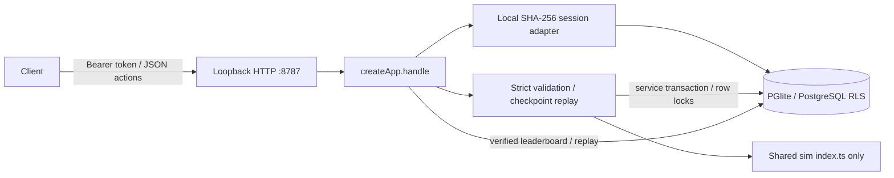
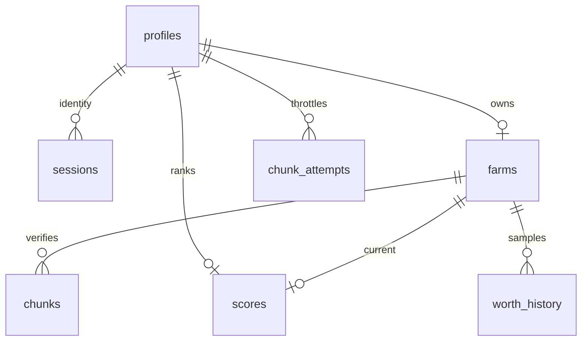

# Workstream S — local server

## Context

Implement D-005/D-006 and the server/simulation contracts without hosted services, Lua execution, package changes, or changes outside S ownership. Local development authentication is not production authentication. Work is uncommitted; no deployment or agents were used. The original ~/Developer/tendril was not accessed.

## Changed locations

All paths below are absolute:

- /Users/rohan/Documents/Qoder/2026-11-11/ca45f3b8/packages/server/src/index.ts — public exports: createApp, initializeDb, Auth, FarmResponse, LeaderEntry.
- /Users/rohan/Documents/Qoder/2026-11-11/ca45f3b8/packages/server/src/app.ts — Fetch Request/Response routes, safe error envelope, authentication seam, strict queries, security headers and explicit loopback CORS.
- /Users/rohan/Documents/Qoder/2026-11-11/ca45f3b8/packages/server/src/auth.ts — local-only random 256-bit opaque tokens, SHA-256 hashes at rest, fresh UUID identity per login.
- /Users/rohan/Documents/Qoder/2026-11-11/ca45f3b8/packages/server/src/db.ts — transactional/idempotent migration startup, transaction-local service role, checked BIGINT conversion.
- /Users/rohan/Documents/Qoder/2026-11-11/ca45f3b8/packages/server/src/validation.ts — streamed 2 MiB raw limit, exact body/action fields and tuples, safe numbers, printable display names, UUID/query validation.
- /Users/rohan/Documents/Qoder/2026-11-11/ca45f3b8/packages/server/src/game.ts — server farm identity/seed/start, locked clone replay, checkpoint preconditions, rolling attempts, scores, sampled growth and public verified replay.
- /Users/rohan/Documents/Qoder/2026-11-11/ca45f3b8/packages/server/src/dev.ts — native node:http runner, bound only to 127.0.0.1:8787, Host allowlist, request timeouts, shutdown, workspace .data persistence.
- /Users/rohan/Documents/Qoder/2026-11-11/ca45f3b8/packages/server/migrations/001_game.up.sql — schema, safe-number constraints, roles, grants, owner/public/service RLS and indexes.
- /Users/rohan/Documents/Qoder/2026-11-11/ca45f3b8/packages/server/migrations/001_game.down.sql — reverse application tables in dependency order; retain potentially shared roles/auth function.
- /Users/rohan/Documents/Qoder/2026-11-11/ca45f3b8/packages/server/test/server.test.ts — 59 deterministic real-PGlite integration/security tests.
- /Users/rohan/Documents/Qoder/2026-11-11/ca45f3b8/brain/notes/S.md — this handoff.

## Decisions and contracts

- Plain parameterized SQL and small explicit validators use only installed dependencies; no ORM/framework/schema library added. Strict tuple lengths supplement sim validation, which otherwise tolerates surplus arguments.
- createApp({db, now?}) returns {handle}. Optional auth is an async Request -> {userId}|null adapter. Supplying auth disables dev login even if devLogin=true; devLogin=false can explicitly hide it for the local adapter too. Injected identities must correspond to existing UUID profiles.
- Local login creates a new identity, never authenticates an existing display name. No clear token is persisted or logged. Production session expiry/revocation and hosted identity provisioning remain outside this local-only task.
- Farms are unique per owner. Checkpoint/chunks/scores/history commit atomically through SET LOCAL ROLE service_role; SELECT FOR UPDATE locks farms, and PGlite serializes transactions across app instances. A failed replay only mutates a deserialized clone, which is discarded. Database-failure rollback is tested after earlier writes.
- Attempts are recorded in a separate committed transaction, with a profile row lock, so rejected JSON/log/oversize submissions cannot evade the 10/user/sliding-hour limit. Rejection never mutates game state; abuse accounting intentionally changes. Nonowners consume their own budget, not the owner's.
- No claimed score fields are accepted. Scores come only from netWorth(replayedWorld). Checkpoint FNV is a precondition/diagnostic, not authentication.
- Actions occur in [fromTick,toTick); raw body <= 2 MiB, actions <= 20,000, tick span <= 20,000. Gate is floor((serverNow-startedAtMs)/100). JSON/query errors are 400; illegal log/shape/future tick 422; bounds 413; version/stale 409; rate 429; missing auth 401; nonowner 403.
- Boards exclude farms without an accepted chunk. Growth uses the most recent history sample at or before now-24h (sample-and-hold), or the earliest available sample for younger farms. The creation sample supplies their initial baseline. It is not lifetime growth for old farms. Same-time samples use identity ordering; ties rank earlier current-score verification, then farm UUID.
- SQL roles anon/authenticated have no checkpoint/score write grants or write policies. Even temporarily granting DML does not bypass RLS (tested). Farms/history are owner-readable, profiles/scores public, chunks owner-readable or public when scored, session hashes/attempts service-private. auth.uid() supports request.jwt.claim.sub and request.jwt.claims; migration does not overwrite a preexisting platform function.
- DOWN intentionally preserves shared roles/auth.uid(). A migration runner must remove schema_migrations version 1 in the same rollback transaction; the down/up test does so.
- CORS allows only http://{localhost,127.0.0.1,[::1]}:{5173,4173,8787}; no wildcard, cookies, null origins, arbitrary ports, or service credentials. Native runner additionally rejects nonloopback Host headers. HTTPS/HSTS belongs to a separately approved hosted deployment, not this loopback HTTP development runner.

## Checks actually performed

- pnpm --filter @tendril/server typecheck — passed before tests and after all edits.
- First pnpm --filter @tendril/server test — 56 passed / 3 failed: DOWN dropped scores before a chunks policy dependency; two test SQL statements had unused numbered parameters. Fixed the migration ordering and test parameter fixtures; no tests deleted or skipped.
- pnpm --filter @tendril/server test — then 59/59 passed (1.60s). Final run after protecting preexisting auth.uid(): 59/59 passed (1.95s).
- pnpm exec eslint /Users/rohan/Documents/Qoder/2026-11-11/ca45f3b8/packages/server/src /Users/rohan/Documents/Qoder/2026-11-11/ca45f3b8/packages/server/test — passed twice.
- git diff --check — passed. Existing unrelated changes/manifests/lockfile were preserved.
- Static server import search for local.ts/lua.ts/wasmoon — no matches; server only uses the shared sim index.
- Actual node /Users/rohan/Documents/Qoder/2026-11-11/ca45f3b8/packages/server/src/dev.ts under Node v26.13.0 / pnpm 10.34.9 — startup, persistence, and shutdown worked.
- Initial HTTP smoke passed login/farm/chunk/me/boards/replay/CORS but its fetch Host assertion failed because fetch did not transmit that override. Replaced only that smoke check with native node:http; actual hostile Host returned 403. Declared-size and chunked-stream bodies >2 MiB both returned safe JSON 413.
- Final actual HTTP orchestration passed login/create-existing/me; stop/restart preserved token and checkpoint; advancing idle chunk to tick 2 accepted; duplicate returned 409; growth/replay returned 200; hostile CORS/Host returned 403; declared and streamed oversized bodies returned 413.
- Smoke servers stopped and port 8787 was confirmed unoccupied. Only the workspace .data directory created by these tests (confirmed absent beforehand) was removed. Subsequent dev startup recreates persistent data; no test accounts remain.

## Trade-offs / assumptions

PGlite's serialized single connection is correct and simple locally, but not a scale architecture. PostgreSQL row locks and constraints preserve the intended transaction boundary for a later adapter. History is verification-time sampled, not continuous wall-clock valuation; no speculative scores are minted between chunks. Manual SQL/validators avoid dependency/configuration expansion at the cost of maintaining those explicit contracts. Display-name sign-in is intentionally unsuitable for production, even behind the Auth seam. Only targeted server checks were run; these do not replace the coordinator's full gate, independent acceptance, or review.

## Integration requests / acceptance

Coordinator-owned changes requested, not made:

- Add @tendril/server script dev: node src/dev.ts (verified native TypeScript execution on installed Node v26.13.0; older runtimes need separately verified support).
- Configure Vite's same-origin /api proxy to http://127.0.0.1:8787 and optional root dev:server command. Keep fixed CORS ports unless a contract update approves others.
- Client should persist its bearer token, restore server farm/checkpoint/seed/start/version rather than invent live farms, and submit only advancing bounded logs. Chunk response deliberately excludes full checkpoint; GET farms/me retrieves it for recovery. Handle 409 by refetching/rebasing, not blind retries; rejected attempts still count.
- Electron file:// has Origin null and is intentionally not CORS-allowed; coordinator must choose a secure same-origin/proxy integration rather than widening to wildcard/null.

Test Engineer suggestions: independently reproduce a harvested score and downloaded replay hash; race two chunks using the same precondition; move clock to the 10 TPS and one-hour boundaries; verify 24h cutoff baselines and earlier-verification ties; directly SET ROLE anon/authenticated with JWT claims; run live declared/chunked oversize and hostile Origin/Host requests. Start the runner on free port 8787 from the absolute path above. Full client wiring, production auth, hosted portability/deployment and full gate are not claimed complete.

## Open questions / remaining risk

- The contract does not forbid toTick=fromTick. Exact-once acceptance of an empty zero-span chunk consumes its unchanged fromTick/hash precondition, so a later advancing submission with that same precondition gets 409. The implementation tests that literal behavior rather than silently changing the seam. Client MUST submit toTick>fromTick. Coordinator decision requested: amend the contract to reject zero-span chunks with 422 before user-facing synchronization, or define a different nonce/precondition rule. This edge is not safe to paper over in client retries.
- Confirm the intended 24h sampled-baseline definition above when reviewing growth acceptance; sparse histories cannot represent an exact continuously valued cutoff.
